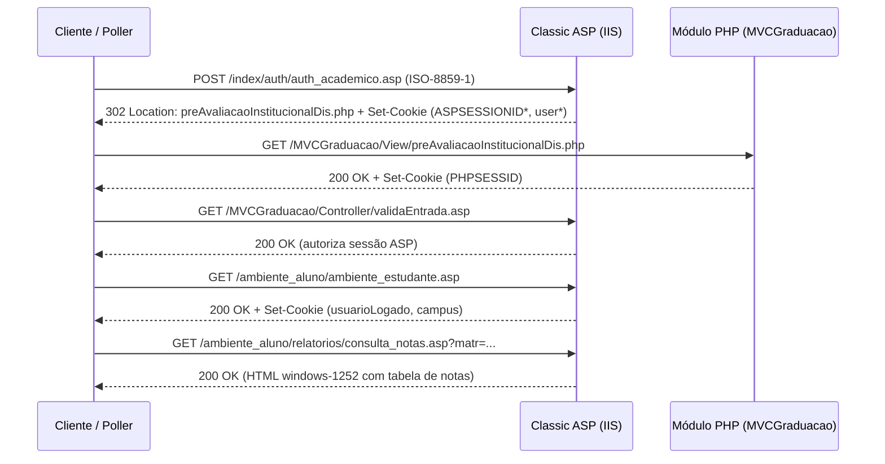

# Documentação Técnica — Portal do Aluno UNICEP (`cdseducacional.com.br`)

Documentação de engenharia reversa (somente leitura) do portal acadêmico da UNICEP São Carlos (`https://cdseducacional.com.br/index/login.php?amb=academico&u=uni`), voltada para a construção de um **painel mobile próprio** (PWA / app / webview) e de um **serviço de monitoramento e notificações de novas notas e faltas**.

---

## 1. Visão Geral da Arquitetura e Stack

| Componente | Detalhe observado |
| :--- | :--- |
| **Servidor Web** | `Microsoft-IIS/10.0` |
| **Back-end** | Híbrido: **Classic ASP (`.asp` / VBScript)** + **PHP `8.5.12`** (e cabeçalho `ASP.NET`) |
| **Front-end (Login e NAC)** | Bootstrap `v3.3.7` + jQuery `v2.2.4` |
| **Front-end (Portal Interno)** | HTML legado gerado no servidor (Dreamweaver templates `.dwt`), layout com `<frameset>` e tabelas (`width="770"`), jQuery `2.2.4` *(exceção: módulo de Atividades Complementares usa Bootstrap `5.3.3` + jQuery `3.7.1`)* |
| **Padrão de API** | Praticamente **100% Server-Side Rendered (HTML)** via `GET`/`POST`; quase nenhum endpoint JSON (apenas o módulo NAC `MVCGraduacao` e o SSO do AVA usam XHR/AJAX) |
| **Charset / Encoding** | **Misto**: formulário de login e relatórios Classic ASP usam **`ISO-8859-1` / `windows-1252`**; páginas PHP (`login.php`, `MVCGraduacao`) usam **`UTF-8`** |

---

## 2. Fluxo de Autenticação, Sessão e "Armadilhas"

### 2.1. Página de Login
- **URL:** `GET https://cdseducacional.com.br/index/login.php?amb=academico&u=uni`
- **Comportamento inicial:** Não cria cookies, não usa `localStorage`/`sessionStorage`, não possui token CSRF, nem CAPTCHA ou 2FA.
- **Formulário:** `<form id="form" method="post" accept-charset="ISO-8859-1">`
  - O `action` não vem no HTML; é atribuído dinamicamente por `js/login.js` no clique do botão `#entrar`:
    - Para `ambiente === "academico"` → `auth/auth_academico.asp`
- **Campos enviados (`application/x-www-form-urlencoded`, encoding `ISO-8859-1`):**
  - `usuario`: RA do aluno (`maxlength="11"`)
  - `senha`: senha (`maxlength="8"`)
  - `txttipo`: perfil (`alunograd`, `alunopos`, `coordenador`, `diretor`, `egresso`, `professorgrad`)
  - `u`: `uni` (hidden)
  - `ambiente`: `academico` (hidden)
  - `campo`: `""` (hidden)

### 2.2. Resposta do Login e Cookies Gerados
Ao enviar `POST https://cdseducacional.com.br/index/auth/auth_academico.asp`:
1. O servidor responde **`HTTP 302`** com:
   - `Location: ../../MVCGraduacao/View/preAvaliacaoInstitucionalDis.php`
2. E define os seguintes cookies (`path=/`, sem flags `HttpOnly` ou `SameSite`):
   - `ASPSESSIONID*` (`secure; path=/`) — sessão do Classic ASP
   - `userCodigo` — ID interno numérico do aluno
   - `userCampus` — nome do campus com espaços codificados como `+`
   - `userRA` — RA do aluno
   - `userName` — nome completo com espaços codificados como `+`
   - `userSemestre` — semestre atual (ex: `2`)

Ao seguir o redirecionamento para `GET /MVCGraduacao/View/preAvaliacaoInstitucionalDis.php`, o PHP define também:
- `PHPSESSID` (`path=/`, sem `HttpOnly`/`Secure`/`SameSite`)

### 2.3. O Portão da Avaliação Institucional (NAC) e `validaEntrada.asp`
Na carga de `/MVCGraduacao/View/preAvaliacaoInstitucionalDis.php`:
- O HTML inicial **já traz visível** a linha `#row-sistema` com o botão `#btn-sistema` (`"Ir para o sistema acadêmico"`).
- Em seguida, um script faz:
  ```http
  POST /MVCGraduacao/Controller/avaliacaoInstitucionalDis.php?acao=verificaPrazoResposta&destinacao=DI
  ```
  Que retorna `{"retorno":"obrigatorio"}` quando há avaliação no período (e o front-end executa `$('#row-sistema').hide()`).
- **Como o botão `#btn-sistema` realmente entra no portal:**
  ```js
  $.get("../Controller/validaEntrada.asp", function(data) {
      if (data !== false) {
          window.location.replace("../../ambiente_aluno/default_amb_est.asp");
      }
  });
  ```
- **Regra crítica descoberta:** A chamada `GET /MVCGraduacao/Controller/validaEntrada.asp` (retorna `200 OK`, 8 bytes) é **obrigatória** para autorizar a sessão `ASPSESSIONID*` no servidor antes de abrir `/ambiente_aluno/ambiente_estudante.asp`.

### 2.4. Entrada no Portal e Autodestruição de Sessão (`session_abandon.asp`)
1. `GET /ambiente_aluno/default_amb_est.asp` retorna um `<frameset rows="1,*">` (`ISO-8859-1`):
   - `topFrame` → `branco.htm` (1px de altura)
   - `base` → `ambiente_estudante.asp`
2. `GET /ambiente_aluno/ambiente_estudante.asp`:
   - **Se a sessão passou por `validaEntrada.asp`:** carrega o painel (`200 OK`) e adiciona mais dois cookies (`path=/`):
     - `usuarioLogado` (RA)
     - `campus` (nome do campus)
   - **Se NÃO passou por `validaEntrada.asp` (ou se a sessão expirou / rota inválida):** responde **`302`** para `https://cdseducacional.com.br/session_abandon.asp`.
3. **Armadilha do `session_abandon.asp`:**
   - Ao ser acessada, essa página **expira imediatamente todos os cookies** (`PHPSESSID`, `userSemestre`, `userName`, `userRA`, `userCampus`, `userCodigo`) e executa `GET /rotinas/logout.php` para destruir a sessão PHP.
   - Em automações/scrapers, qualquer `302` apontando para `session_abandon.asp` ou `login.php` significa que a sessão foi encerrada e é preciso autenticar do zero.



---

## 3. Mapa Completo de Rotas e Menu do Portal

Todas as rotas abaixo estão sob `https://cdseducacional.com.br` e exigem os cookies de sessão autenticada:

| Item do Menu | Método e Rota | Alvo original | Descrição |
| :--- | :--- | :--- | :--- |
| **Alterar senha** | `GET /ambiente_aluno/alterar_senha.asp` | frame `base` | Formulário de troca de senha |
| **Banco de empregos** | `GET /ambiente_aluno/vagas.asp` | frame `base` | Mural de vagas |
| **Boletim on-line** | `GET /ambiente_aluno/relatorios/boletim_geral.asp` | frame `base` | Seletor de período que abre `boletim_detalhado.asp` |
| **Visualizar disciplinas** | `GET /modulo_matricula/relatorios/ficha_individual_todas_semDuplicidade.asp` | `_blank` | Ficha individual / histórico completo (cursadas e a cursar) |
| **Consultar notas parciais e média final** | `GET /ambiente_aluno/consulta_notas_primeira.asp` | frame `base` | Seletor de período que abre `relatorios/consulta_notas.asp` |
| **Horário das aulas** | `GET /ambiente_aluno/relatorios/quadro_horarios.asp` | `_blank` | Grade horária do semestre |
| **Visualizar grade** | `GET /modulo_matricula/relatorios/relatorio_matriz_curricular_apartir_2025_unicep.asp?grade=<id>` | popup | Matriz curricular completa por período |
| **Declaração de pagamento** | `GET /financeiro/relatorios/declaracao_imposto_renda.asp` | popup | Declaração anual para IR |
| **Impressão de documentos on-line** | `GET /modulo_matricula/relatorios/docs_online/gerarDocs.php` | popup | Gerador de documentos em PHP |
| **UnicepVirtual** | `GET /d2l_login.php?ra=<RA>&nocache=<rand>` | XHR + `_blank` | Retorna URL SSO para o LMS D2L Brightspace |
| **Documentos Institucionais** | `GET /ambiente_aluno/documentos_institucionais.asp` | `_blank` | Lista estática de PDFs/DOCs (Guia, Estatuto, Regimento, PDI etc.) |
| **Pagamento Mensalidade** | `GET /ambiente_aluno/pagamentoMensalidade.asp` | `_blank` | Portal de pagamento |
| **Requerimentos diversos** | `GET /solicitacaoDocumentos/solicitacaoDocumento.asp` | popup | Solicitação de documentos/protocolos |
| **Localização de Salas** | `GET /ambiente_aluno/Localizacao_salas_v1.pdf` | `_blank` | Mapa em PDF das salas do campus |
| **Consulta de mensalidades (semestre vigente)** | `GET /ambiente_aluno/relatorios/listaDebito.asp` | `_blank` | Lista de mensalidades (Vencimento, Status, Valor bruto, Valor com desconto) |
| **Atividades complementares** | `GET /ambiente_coordenador_novo/controle_atividades_complementares/aluno.asp` | `_blank` | Envio e consulta de certificados (Bootstrap 5.3.3) |
| **Sair do sistema** | `GET /session_abandon.asp` | frame `base` | Encerra sessão ASP + chama `/rotinas/logout.php` |

### Conteúdo da Home (`ambiente_estudante.asp`)
- Saudação com nome completo e data por extenso.
- Formulário de atualização cadastral (`form[name="form1"]`: e-mail e telefones).
- Endereço cadastrado.
- Links de matrícula do semestre atual:
  - Contrato e Documentação de Matrícula (PDF em `/symLinkFTP/...`)
  - Confirmação de Matrícula (`/ambiente_aluno/matricula/matricula_confirmacao.asp?codigoMatricula=<codigo>`)
- Bloco `AVISO` estático da coordenação.
- Não há requisições AJAX de dashboard na carga da home.

---

## 4. Detalhamento Técnico: Notas, Boletim e Histórico

Estas são as telas essenciais para o seu **painel mobile** e para o **monitor de novas notas**. Todas entregam HTML estático leve (~21 KB) sem dependência de JavaScript na renderização da tabela.

### 4.1. Notas Parciais e Média Final (Provas, Trabalhos e Pesos)

#### Passo 1 — Descobrir os períodos disponíveis
- **Endpoint:** `GET /ambiente_aluno/consulta_notas_primeira.asp`
- **Elemento no DOM:** `<select name="cboPeriodo" id="cboPeriodo">`
- **Formato dos `<option>`:**
  - `value="0"` → `[SELECIONE O PERÍODO]`
  - `value="<codigoMatricula>@@<sem>@@<ano>"` (ex: `999999@@2@@2026` para `- 2º semestre de 2026`)

> **Importante:** Sempre leia `cboPeriodo` dinamicamente em vez de fixar `codigoMatricula`, porque esse código muda a cada rematrícula semestral.

#### Passo 2 — Buscar a tabela de notas do período
- **Endpoint:** `GET /ambiente_aluno/relatorios/consulta_notas.asp?matr=<codigoMatricula>@@<sem>@@<ano>`
- **Charset da resposta:** `windows-1252` (`iso-8859-1`)
- **Seletor da tabela:** `form[name="form1"] > table > tbody > tr > td > table.topoesq` (a tabela de dados **não possui atributo `id`**)
- **Estrutura das linhas:**
  - Cabeçalho (`tr.texto` / primeira linha) e linhas de disciplinas (`tr.texto2`), cada célula dentro de `td.basedir > div` (ou `td.basedir`).
- **19 Colunas exatas (em ordem):**
  1. `Código` (ex: `19280403`)
  2. `Nome da Disciplina`
  3. `P1` (Prova 1)
  4. `P2` (Prova 2)
  5. `P3` (Prova 3)
  6. `P4` (Prova 4)
  7. `T1` (Trabalho 1)
  8. `T2` (Trabalho 2)
  9. `T3` (Trabalho 3)
  10. `T4` (Trabalho 4)
  11. `Média`
  12. `%P1` (peso da P1)
  13. `%P2` (peso da P2)
  14. `%P3` (peso da P3)
  15. `%P4` (peso da P4)
  16. `%T1` (peso do T1)
  17. `%T2` (peso do T2)
  18. `%T3` (peso do T3)
  19. `%T4` (peso do T4)

- **Regras de formatação observadas nas células:**
  - Os textos vêm cercados de espaços e quebras de linha dentro dos `<div>` → **sempre aplicar `.trim()`**.
  - Nota não lançada ou peso não utilizado aparece como **`-`**.
  - Notas decimais usam **vírgula** (`7,7`, `8,8`, `3,98`, `8,68`); notas inteiras omitem casas decimais (`10`, `9`, `7`).
  - Médias abaixo do critério mínimo vêm envolvidas em `<span style="color:red">...</span>` (ex: `5,00`, `3,98`).
  - Não existe modal, detalhe oculto nem requisição extra ao clicar em notas ou disciplinas.
  - Não existe endpoint de exportação PDF.

---

### 4.2. Boletim On-line (Média Final, Faltas, Frequência e Situação)

#### Passo 1 — Descobrir os períodos disponíveis
- **Endpoint:** `GET /ambiente_aluno/relatorios/boletim_geral.asp`
- **Elemento no DOM:** `<select name="cboPeriodo" id="cboPeriodo">`
- **Formato dos `<option>`:** cada `value` já vem montado como a **query string completa** (com `ISO-8859-1` URL-encoded, ex: `Computa%E7%E3o`):
  ```text
  ?ra=<RA>&nomealu=<NOME>&nomecur=<CURSO>&ano=<ANO>&sem=<SEM>&grade=<GRADE>&anograde=<ANO_GRADE>&mesgrade=<MES_GRADE>&codigoMatricula=<COD_MAT>
  ```

> **Dica de implementação:** Extraia o atributo `value` do `<option>` exatamente como retornado pelo HTML de `boletim_geral.asp` e anexe diretamente em `boletim_detalhado.asp`. Se tentar montar a string em UTF-8 manualmente, caracteres acentuados no `nomecur` podem quebrar.

#### Passo 2 — Buscar o boletim do período
- **Endpoint:** `GET /ambiente_aluno/relatorios/boletim_detalhado.asp<queryStringDoOption>`
- **Charset da resposta:** `windows-1252` (`iso-8859-1`)
- **Seletor da tabela:** `table.topoesq` (cabeçalho `tr.texto`, linhas de dados `tr.texto2`, células `td.basedir > div`).
- **9 Colunas exatas (em ordem):**
  1. `Código` (ex: `19280403`)
  2. `Nome da Disciplina`
  3. `Dt.Atual.` — data da última atualização de frequência (`dd/mm/yyyy`) ou espaço em branco (`&nbsp;`)
  4. `Turma` — ex: `Turma A` (ou vazio para Atividades Complementares)
  5. `MF` — Média Final com 2 casas decimais e vírgula (`5,00`, `8,68`) ou `-` se não lançada
  6. `CH` — Carga Horária em horas inteiras (`60`, `40`, `20`, `0`)
  7. `FA` — Total de Faltas em inteiro (`0`, `3`, `10`, `12`)
  8. `Freq. (%)` — Frequência em percentual inteiro (`100`, `95`, `80`) ou `-`
  9. `Sit.` — Código de 1 letra da situação:
     - `C` = Cursando
     - `A` = Aprovado
     - `R` = Reprovado
     - `T` = Trancado
     - `X` = Cancelado
     - `F` = Transferido
     - `P` = Pendente
- **Linhas finais de resumo (`colspan="9"`):**
  - `Hora(s) de Atividade(s) Complementar(es) no Semestre: (X h).`
  - `Total de Hora(s) de Atividade(s) Complementar(es) : (Y h).`

---

### 4.3. Ficha Individual / Histórico Completo
- **Endpoint:** `GET /modulo_matricula/relatorios/ficha_individual_todas_semDuplicidade.asp`
- **Charset:** `windows-1252` (`iso-8859-1`)
- **Conteúdo:** Lista todas as disciplinas da grade do aluno (dos 8 semestres), separadas visualmente por linhas tracejadas.
- **Colunas:** `Disciplina`, `Ano` (`1 / 2026`, `2 / 2025`, ou `/` se não cursada), `Exame`, `Média`, `CH`, `FA`, `Freq. (%)` (com 2 casas decimais, ex: `95,00`), `Sit.` (`A`, `C` ou vazio).
- Cada disciplina traz um link para `relatorio_dadosdisciplinas.asp?grade=<id>&discgrad=<id>`.

---

## 5. Guia de Implementação para o Novo Painel + Notificações

Como o portal da faculdade não possui API JSON e mistura sessões ASP/PHP com charset `ISO-8859-1`, a arquitetura mais limpa e confiável é criar um **pequeno backend (BFF + Poller)** que conversa com o portal e expõe uma **API JSON limpa em UTF-8** para um front-end mobile (PWA em React/Next.js/SvelteKit ou app nativo).

```text
[ Portal UNICEP (ASP/PHP) ]
           ▲
           │ HTTP + Cookie Jar + Decode windows-1252
           │
[ Backend BFF + Worker Poller (Node.js/TS ou Python) ]
     ├──► Armazena snapshot das notas/faltas (SQLite / Postgres)
     ├──► Dispara notificação ao detectar mudança (ntfy / Telegram / Web Push)
     └──► Expõe API REST JSON (UTF-8)
           │
           ▼
[ Painel Mobile (PWA responsivo) ]
```

### 5.1. Cuidados Obrigatórios no Scraper / Cliente HTTP
1. **Cookie Jar Único e Persistente:** Use um cliente HTTP com suporte a cookies entre redirecionamentos e sub-requisições (ex: `tough-cookie` + `axios`/`got` em Node, ou `httpx.AsyncClient` / `requests.Session` em Python) para manter `ASPSESSIONID*`, `PHPSESSID` e todos os cookies `user*` juntos.
2. **Codificação de Entrada e Saída:**
   - No `POST /index/auth/auth_academico.asp`, serialize o corpo em `ISO-8859-1` (`latin1`) — especialmente importante se a senha ou campos tiverem caracteres acentuados.
   - Nas respostas de `consulta_notas.asp`, `boletim_detalhado.asp` e `ficha_individual_todas_semDuplicidade.asp`, decodifique o buffer bruto usando **`windows-1252` / `iso-8859-1`** (`iconv-lite` no Node ou `response.content.decode("cp1252")` no Python) antes de passar para o parser HTML. Caso contrário, nomes como `"Computação"` e `"Média"` ficarão corrompidos.
3. **Sequência Segura de Sessão:**
   - Passo 1: `POST /index/auth/auth_academico.asp` (sem seguir `302` automaticamente se quiser inspecionar `Location`, ou seguindo até `preAvaliacaoInstitucionalDis.php`).
   - Passo 2: `GET /MVCGraduacao/Controller/validaEntrada.asp` (essencial para liberar a sessão ASP).
   - Passo 3: `GET /ambiente_aluno/ambiente_estudante.asp` (para registrar `usuarioLogado` e `campus`, ou validar que não houve redirect para `session_abandon.asp`).
   - Passo 4: Ler os períodos em `consulta_notas_primeira.asp` e `boletim_geral.asp` e consultar `consulta_notas.asp` e `boletim_detalhado.asp`.
4. **Detecção de Sessão Expirada:**
   - Sempre faça requisições com tratamento explícito de `302`: se o header `Location` contiver `session_abandon.asp` ou `login.php`, descarte o cookie jar, refaça o login completo (Passos 1–3) e repita a consulta.
5. **Parsing Robusto das Tabelas:**
   - Como `table.topoesq` não tem `id`, localize a tabela verificando se a primeira linha contém os cabeçalhos esperados (`Código` e `Nome da Disciplina`).
   - Mapeie colunas pelo texto do cabeçalho (e não só por índice fixo), fazendo `.trim()` e convertendo vírgula decimal (`"8,68"`) para `number` (`8.68`) e `"-"` para `null`.

### 5.2. Lógica do Monitor de Novas Notas (Poller)
1. **Frequência recomendada:** Rode o job em segundo plano a cada **15 ou 30 minutos** (evite intervalos de segundos para não sobrecarregar o IIS da faculdade nem gerar bloqueio).
2. **Estrutura do Snapshot para Comparação:**
   Indexe cada disciplina do semestre vigente pelo `codigo`:
   ```json
   {
     "19280403": {
       "nome": "EXEMPLO DE DISCIPLINA",
       "notas": {
         "P1": "8,5", "P2": null, "P3": null, "P4": null,
         "T1": "10",  "T2": null, "T3": null, "T4": null,
         "media": null
       },
       "pesos": {
         "P1": "70", "P2": null, "T1": "30"
       },
       "boletim": {
         "mf": null,
         "fa": 4,
         "freq": 93,
         "dtAtual": "12/11/2026",
         "sit": "C"
       }
     }
   }
   ```
3. **Quando notificar:**
   - **Nota nova ou alterada:** Sempre que um campo em `notas` (`P1..P4`, `T1..T4`, `media`) mudar de `null` (`-`) para um valor numérico, ou mudar de um valor anterior para outro (retificação de nota).
   - **Falta lançada (opcional):** Quando `boletim.fa` aumentar ou `boletim.dtAtual` mudar.
   - **Primeira execução (seed):** Salve o snapshot inicial **sem enviar notificações**, para evitar disparar alertas de todas as notas antigas de uma vez.
4. **Canais simples de notificação para celular:**
   - **[ntfy.sh](https://ntfy.sh)** (gratuito, basta um `POST` simples e instalar o app no celular — ideal para uso próprio).
   - **Bot do Telegram** (um `POST` na Bot API).
   - **Web Push API** (se você hospedar o novo painel como PWA).

### 5.3. Ideias de Melhorias no Novo Painel Mobile
- **Cards por disciplina** em vez de tabelas largas de 19 colunas com scroll horizontal (exibindo só as provas/trabalhos que possuem peso ou nota lançada).
- **Simulador de "quanto preciso na P2"**: usando os pesos `%P1..%P4` e `%T1..%T4` que já vêm em `consulta_notas.asp`, calcular automaticamente quanto falta para atingir a média de aprovação.
- **Indicador visual de faltas**: calcular quantas faltas ainda restam antes de estourar os 25% permitidos com base na carga horária (`CH`) vinda de `boletim_detalhado.asp`.
- **Histórico de notificações**: linha do tempo mostrando data/hora em que cada nota foi detectada pelo seu monitor.
