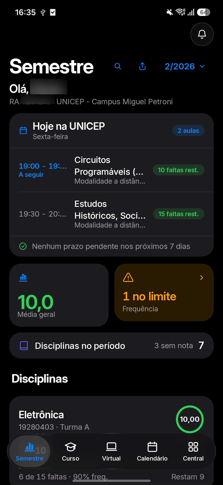
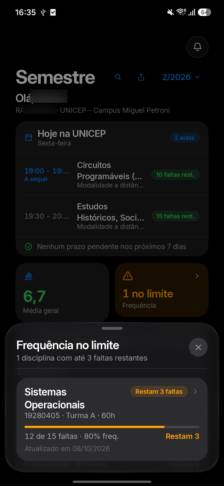
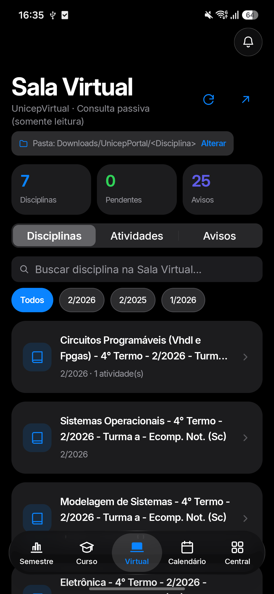
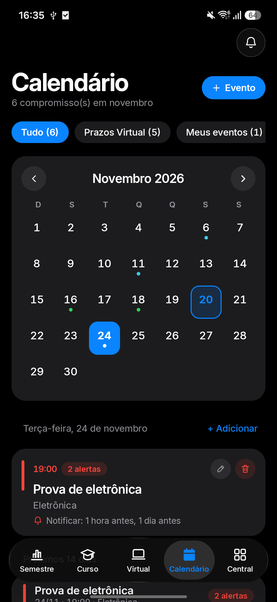
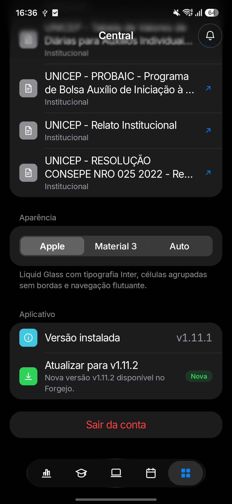
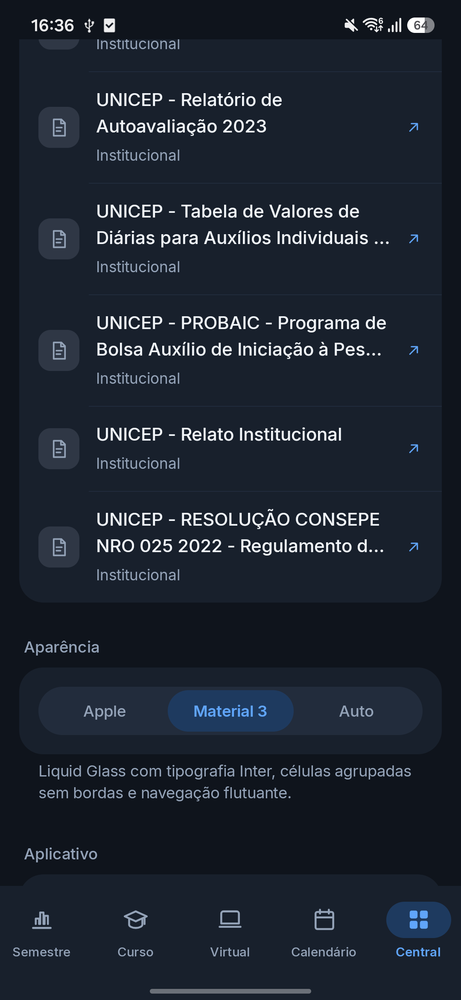

# UNICEP Portal

Cliente moderno, rápido e auto-hospedado para o Portal do Aluno da UNICEP (`cdseducacional.com.br`), composto por um **backend BFF em Go + SQLite** e um **frontend único em Kotlin + Compose Multiplatform** para **Android** e **Web (WebAssembly)**.

---

## Capturas de Tela

### Visão do Semestre e Frequência no Limite (Estilo Apple)

| Semestre | Frequência no limite |
| :---: | :---: |
|  |  |

### Sala Virtual (D2L) e Calendário Unificado

| Sala Virtual | Calendário |
| :---: | :---: |
|  |  |

### Central e Alternância Visual (Apple vs Material Design 3)

| Estilo Apple | Material Design 3 |
| :---: | :---: |
|  |  |

---

## Principais Recursos

- **Acompanhamento do Semestre:** notas parciais, médias, faltas restantes e simulador de média por disciplina.
- **Alerta de Frequência no Limite:** destaque interativo para matérias com até 3 faltas restantes, com ordenação pela menor margem.
- **Sala Virtual (UnicepVirtual · D2L Brightspace):** integração passiva (somente leitura) com disciplinas, conteúdos, prazos de atividades, avisos, calendário, visualizador nativo de PDFs/imagens no Android e download organizado em subpastas por disciplina (inclusive via SAF).
- **Visão do Curso:** histórico escolar, grade curricular, horários, financeiro e atalhos institucionais (incluindo UnicepVirtual / D2L SSO).
- **Notificações de Notas, Faltas e Prazos:** poller em segundo plano no servidor Go com deduplicação em SQLite, avisos de novas atividades postadas e lembretes customizáveis antes do prazo no Android via `WorkManager`.
- **Design System Dual (Apple / Material Design 3):** interface adaptativa com números tabulares (`tnum`), fallback automático em aparelhos Android mais antigos/econômicos e alternador manual na aba *Central*.
- **Auto-update no Android:** verificação automática de novas releases no Forgejo com download e instalação guiada do APK dentro do aplicativo.

---

## Arquitetura e Segurança

- **Backend (`backend/`) — Go 1.24 + SQLite:**
  - Credenciais criptografadas em repouso com **AES-256-GCM** e chaves derivadas via HMAC-SHA256.
  - Autenticação via JWT (`Authorization: Bearer`) com revogação real por `token_version` no logout.
  - Proxy para páginas legadas e arquivos da Sala Virtual via **tickets opacos de uso único** (`POST /api/proxy/ticket`, `POST /api/d2l/ticket`) e `Content-Security-Policy: sandbox`.
  - Rate limiting por IP e RA, validação estrita de `CF-Connecting-IP` apenas para proxies confiáveis e headers CSP/COOP/X-Frame-Options rígidos.
- **Frontend (`app/`) — Kotlin + Compose Multiplatform:**
  - **Android:** compilado com R8 (`1,9 MB`), armazenamento seguro via **Android Keystore** e tráfego HTTP bloqueado fora de loopback local.
  - **Web (`wasmJs`):** servido diretamente pelo container Go na raiz `/`, com histórico de navegação integrado (`Mouse 4/5`).

---

## Rodando no Homelab com Docker (Forgejo Registry + Watchtower)

1. Copie [`docker-compose.yml`](docker-compose.yml) e [`.env.example`](.env.example) para uma pasta no servidor e crie o `.env`:
   ```bash
   cp .env.example .env
   openssl rand -hex 32   # defina o valor gerado em APP_SECRET (mínimo 32 caracteres)
   ```

2. Baixe a imagem pública do Forgejo e suba a stack:
   ```bash
   docker compose pull
   docker compose up -d
   ```
   O serviço `watchtower` verifica atualizações no Forgejo Registry a cada 5 minutos (`300s`) e reinicia o container `unicep-portal` automaticamente mantendo o volume persistente `unicep_data`.

3. Exponha `http://127.0.0.1:47832` via **Cloudflare Tunnel** ou **Nginx + Certbot** (modelo em [`deploy/nginx-unicep.conf.example`](deploy/nginx-unicep.conf.example)).

---

## Desenvolvimento e Publicação

- **Testes do backend Go (com race detector):**
  ```bash
  cd backend && go test -count=1 -v -race ./...
  ```
- **Build do site Web (`wasmJs`):**
  ```bash
  cd app && ./gradlew :composeApp:wasmJsBrowserDistribution -PwebOnly=true
  ```
- **Build do APK Android Release (R8):**
  ```bash
  cd app && ./gradlew :androidApp:assembleRelease
  ```
- **Publicar nova imagem Docker no Forgejo:**
  ```bash
  ./scripts/publish-image.sh
  ```

Mais detalhes de arquitetura, segurança e releases estão em [`AGENTS.md`](AGENTS.md) e [`DOCUMENTACAO_PORTAL.md`](DOCUMENTACAO_PORTAL.md).

---

## Licença

Distribuído sob a licença **GNU General Public License v3.0 (GPL-3.0-or-later)**. Veja [`LICENSE`](LICENSE).
